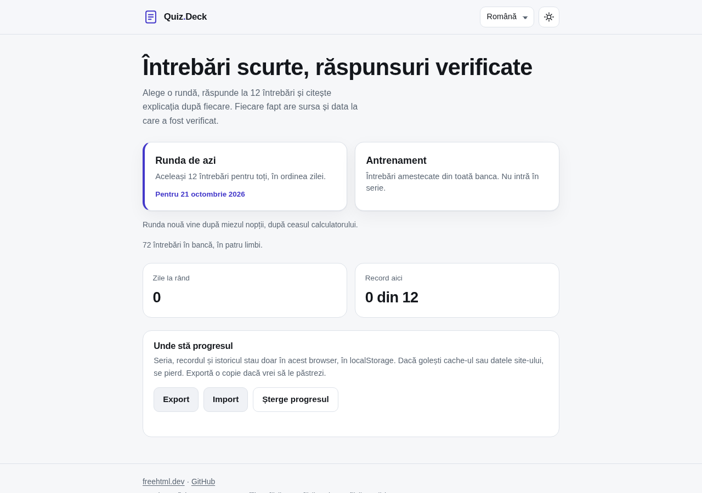

# Quiz-Deck

**Twelve short questions, four answers, one correct, and the source for every fact.**

[](https://tekideki.github.io/Quiz-Deck/)
[](LICENSE)



A round of twelve questions from seven subjects. Answer, read why, and see where the fact comes from. The daily round is dealt from the date itself, so everybody who opens the page on the same day gets the same twelve questions in the same order, with no server behind it.

No account, no upload, no tracking, no advertising. One HTML file, and it works offline.

## What it does

- **A round of twelve.** One question at a time, four options, one of them right. The options are shuffled, and the shuffle is seeded, so a shared round deals the identical screen to the next person.
- **The answer, then the reason.** Every question carries an explanation, a named source and the date the bank was checked. Nothing is left as "trust me".
- **The daily round.** Today's twelve come from the date. Send your score as a link and the person who opens it plays exactly the same questions.
- **Your own record.** The streak of days and the best score live in this browser, in `localStorage`. The page says plainly that clearing the cache or the site data wipes them, and offers **Export** and **Import** so a copy can survive.
- **Practice.** A mixed round from the whole bank, outside the streak and outside the record.
- **The mistakes again.** After a round, the wrong answers are listed with the right one, the explanation and the source, and can be replayed as a short round.
- **Keyboard and theme.** Keys 1 to 4 pick an answer, Enter moves on. Light and dark, remembered between visits.
- **Four languages.** English, Romanian, Serbian Latin and Serbian Cyrillic. The questions themselves exist in all four, not just the buttons.

## Where the questions come from

The bank is written once per question, in English, Romanian and Serbian Latin. The Cyrillic version is produced by the build, so it cannot drift from the Latin one.

The rules for what may enter the bank are strict on purpose:

- Facts that do not move: arithmetic, logic, geometry, fixed geography, physical and chemical constants, the meaning of a word, a date that is settled.
- Nothing that changes with the news: no current events, no sport results, no records, no holders of an office, no prices.
- No medical, legal or financial advice.
- Calculations are shown step by step in the explanation, so the arithmetic can be checked on paper.
- Every item has a source and the bank has one date of the last check, printed under each explanation.

If a fact is still wrong, the footer links to the issue tracker. That is the honest version of "accurate": a source, a date and a way to report a mistake.

## Why it is built this way

**No server, and still the same round for everyone.** The daily twelve are picked by a small deterministic generator: a hash of the date seeds an xorshift shuffle, topics take turns, and each question's four options are shuffled by a seed made of the question id and the date. Same date, same screen, on every machine, with no database and no clock to trust.

**The progress is local, and it says so.** `localStorage` holds the days played, the streak and the record. The start screen warns that a cleared cache takes them away, and the JSON export is one click.

**The fourth script is generated.** Serbian Cyrillic is transliterated from Serbian Latin by `build.py`, for the interface and for the bank. A check in the build fails if a Latin letter survives where it should not.

**The build refuses sloppiness.** Em dash, en dash, no-break space, byte order mark, a missing locale, a repeated option, two identical questions, a source that points at nothing: each one stops the build.

## Tests

```bash
node tests/logic_test.cjs     # the bank, the generator, the streak, the import, the built page
python3 tests/ui_test.py      # the page in Chromium, played through, served from a local folder
```

The logic test deals the same day twice and expects the same round, walks every day of four months and expects every question to appear, feeds the progress file junk and expects it to be dropped, and reads the built page back to compare it with the sources.

The browser test plays a whole daily round through the keyboard, checks that the explanation and the source appear, reads `localStorage`, follows a challenge link, plays practice and expects nothing to be written to the record, exports and imports the progress, erases it, switches to Cyrillic and checks that the same question turns with it, and fails on any console error or any request that leaves the local server. It also reloads with the network off.

## Development

```bash
python3 build.py            # writes index.html from src/, byte for byte
```

`src/bank/items.json` is the bank, `src/i18n/locales.json` the interface strings, `src/core.js` the pure helpers that the tests also load, `src/app.js` the page, `src/styles.css` the theme. Deploying means bumping `VERSION` in `sw.js`, because the old cache is dropped then.

## License

Apache 2.0. The questions are written for this project; the sources named next to them belong to their authors.
